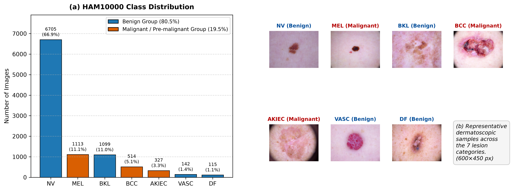
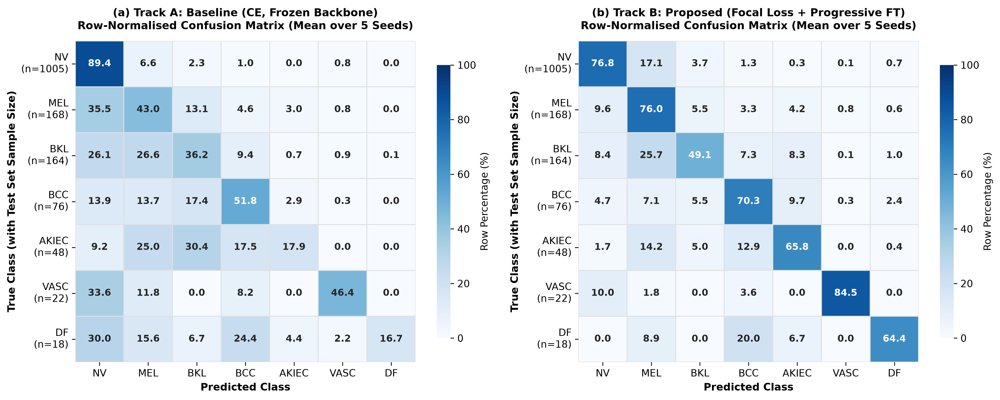
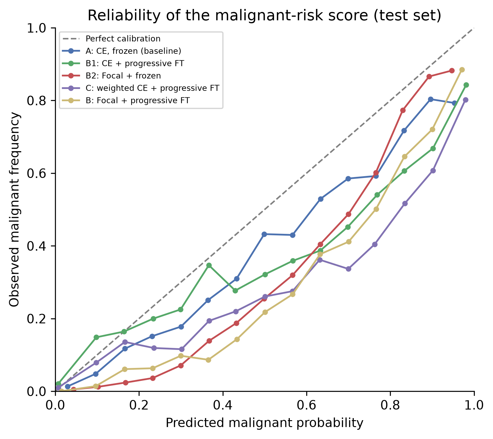
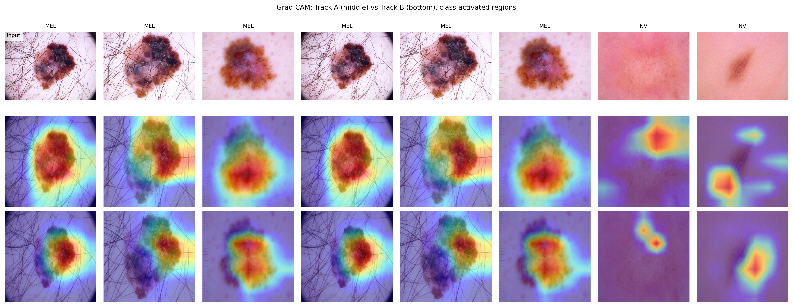

# Skin Lesion Classification on HAM10000

A seven-class skin lesion classifier built on ResNet50, where the real question was not "how high can accuracy go" but **"how do I stop the model from missing melanomas"**.

On this dataset a model can look fine with 73% accuracy and still miss more than half of the melanomas. I ran 5 configurations × 5 random seeds to find out which change actually moves that number.

## The problem

HAM10000 has 10,015 dermoscopy images in 7 classes, and the classes are very unbalanced: `nv` (benign mole) is about 67% of the data, while `mel` (melanoma), `bcc` and `akiec` are rare. A model trained with plain cross entropy learns "when in doubt, say nv" and gets a nice accuracy while being useless for the thing that matters.

So I treated **melanoma recall** and **malignant recall** (mel/bcc/akiec grouped) as the primary metrics, and accuracy as a secondary one.

## Results (mean ± std over 5 seeds, test set)

| Track | Loss | Backbone | Acc | Malignant recall | Melanoma recall | Macro F1 | Macro AUROC |
|---|---|---|---|---|---|---|---|
| A | CE | frozen | 72.7 ± 0.8 | 56.8 ± 6.5 | 43.0 ± 7.5 | 44.8 ± 3.7 | 90.1 ± 0.4 |
| B1 | CE | progressive FT | **80.2 ± 0.9** | 71.8 ± 2.4 | 56.2 ± 5.1 | 67.5 ± 1.9 | 95.3 ± 0.4 |
| B2 | Focal | frozen | 66.3 ± 4.5 | 74.0 ± 8.8 | 59.0 ± 13.8 | 46.5 ± 2.5 | 89.5 ± 0.3 |
| C | Weighted CE | progressive FT | 75.8 ± 2.6 | 80.9 ± 2.9 | 71.3 ± 5.3 | 65.1 ± 4.0 | 94.8 ± 0.5 |
| B | Focal | progressive FT | 73.0 ± 3.5 | **86.0 ± 1.3** | **76.0 ± 2.7** | 64.3 ± 4.4 | 94.2 ± 0.5 |

What the numbers say:

- **Freezing the backbone is the worst choice for recall.** Baseline A misses 57% of melanomas. That is the failure mode I wanted to fix.
- **Progressive fine-tuning is what buys accuracy.** B1 vs A: 72.7 → 80.2 accuracy, and melanoma recall 43.0 → 56.2.
- **The loss function is what buys recall.** B vs B1: same backbone schedule, only the loss changes (focal vs CE), melanoma recall 56.2 → 76.0, malignant recall 71.8 → 86.0. Accuracy drops 80.2 → 73.0, which is the trade I was willing to make.
- **Focal loss with a frozen backbone is unstable** — B2 has the widest spread (melanoma recall 59.0 ± 13.8) and the lowest accuracy. Focal loss needs the backbone to adapt with it.
- **C is the compromise.** 75.8 accuracy and 71.3 melanoma recall — if you will not accept a 7-point accuracy drop, weighted CE is the better lever.

## Extra analyses

`06_extras.py` reruns the same seeds for three more questions: does the focal-loss gain depend on gamma, are the probabilities usable as probabilities, and how does the model behave at a fixed sensitivity target.

**Gamma is not the lever.** Track B at gamma = 1 and 3, five seeds each, against the shipped gamma = 2:

| gamma | Acc | Malignant recall | Melanoma recall | Macro F1 | Macro AUROC |
|---|---|---|---|---|---|
| 1 | 75.0 ± 5.0 | 82.8 ± 4.3 | 70.8 ± 7.6 | 65.3 ± 4.8 | 94.6 ± 0.8 |
| 2 (Track B) | 73.0 ± 3.5 | 86.0 ± 1.3 | 76.0 ± 2.7 | 64.3 ± 4.4 | 94.2 ± 0.5 |
| 3 | 74.5 ± 3.2 | 83.6 ± 3.5 | 71.1 ± 5.2 | 65.3 ± 2.9 | 94.3 ± 0.5 |

Every gap here is within one seed standard deviation. Gamma = 2 is best on malignant recall and the tightest across seeds, but I would not claim the sweep proves an effect.

**Calibration is the price of the recall.** Expected calibration error on test, 7-class and malignant-only:

| Track | ECE 7-class | ECE malignant | Brier (malignant) |
|---|---|---|---|
| A | 0.034 | 0.069 | 0.118 |
| B1 | 0.074 | 0.064 | 0.095 |
| B2 | 0.093 | 0.187 | 0.150 |
| C | 0.079 | 0.109 | 0.118 |
| B | 0.038 | 0.146 | 0.126 |

A has the best 7-class ECE (0.034) and Track B is close (0.038). The malignant probability is where focal loss hurts: B 0.146, B2 0.187, against A 0.069 and B1 0.064. If the score is going to be read as a melanoma probability, the extra recall comes with a calibration bill.

**Fixing a sensitivity target makes the trade explicit.** The threshold is selected on validation for a target malignant sensitivity, then applied once to test (mean over five seeds):

| Track | Target sens | Test sens | Test spec | Test precision |
|---|---|---|---|---|
| B | 90% | 92.2% | 69.9% | 42.6% |
| B | 95% | 96.0% | 60.8% | 37.2% |
| B | 99% | 99.8% | 44.1% | 30.2% |
| C | 95% | 97.3% | 62.7% | 38.7% |
| A | 95% | 96.0% | 49.3% | 31.4% |

At 95% sensitivity B keeps more specificity than A (60.8% vs 49.3%), so the recall gain is not handed back at the operating point.

**Where it still fails.** Error decomposition by metadata: on Track A, patients aged 80+ are classified at 27.0% accuracy (37 images) while 40-59 is 76.7%. Track B lifts the 80+ group to 44.9% and the 40-59 group to 77.4%. By class, A sends 35.5% of melanomas to nv; B sends 9.6%, but 25.7% of bkl are now called melanoma. That is the cost of the recall.

## How the data was split

This part matters more than the model. HAM10000 has multiple images per lesion (`lesion_id`), so a plain random split leaks the same mole into train and test and the score becomes fake.

I used `StratifiedGroupKFold` grouped by `lesion_id` for a 70/15/15 split, and the script asserts that the train, val and test lesion sets do not overlap (it prints `Zero lesion_id overlap` when it passes). The manifest is `results/splits.csv` if you want to check.

## Setup

- Backbone: ResNet50 (ImageNet pretrained), new 7-way head, dropout 0.3
- Progressive unfreezing: head → layer4 → layer3, with different learning rates per stage
- Losses compared: plain CE, focal loss (γ=2), inverse-frequency weighted CE
- 5 seeds per track: 42, 100, 2026, 7, 99 — every number above is a mean over 5 full runs, not a lucky one
- Metrics computed per run and saved to `results/metrics/*.json`

## Repository layout

```
01_prepare_data.py            dataset download / cleanup, grouped split, leakage check
02_core_modules.py            Dataset, FocalLoss, class weights, ResNet50 wrapper, unit tests
03_run_experiments.py         5 tracks × 5 seeds, training, evaluation, per-run metrics
04_polish_plots_and_stats.py  plots and the cross-seed statistics
05_build_word_report.py       builds the Word report from the metrics
06_extras.py                  gamma sweep, calibration, thresholds, error decomposition, Grad-CAM
figures/                      EDA, confusion matrices, reliability diagram, Grad-CAM, slide versions
results/                      all_test_results.csv, splits.csv, 35 per-run metric files, test/validation predictions
results/extras_*.csv          gamma sweep, calibration, threshold and subgroup tables
```

`02_core_modules.py` has a `run_unit_tests()` that checks the dataset shapes and the loss values before any training starts — running that first saved me a few silent failures.

## Figures

**Class distribution and image samples (EDA)**



**Confusion matrices for the five tracks**



**Reliability diagram: predicted confidence vs observed accuracy**



**Grad-CAM for Track A and Track B**



## Environment

```bash
python -m venv .venv && source .venv/bin/activate
pip install -r requirements.txt
```

The dataset is not in this repo (about 3GB). `01_prepare_data.py` can download it or point at a local folder, and it expects the standard `HAM10000_metadata.csv` + two image folders.

Model weights are not uploaded either (about 90MB per checkpoint, 35 in total). Run `03_run_experiments.py` to reproduce a track, or load the metrics in `results/` if you only want to see the numbers.

## License

MIT — see [LICENSE](LICENSE).
