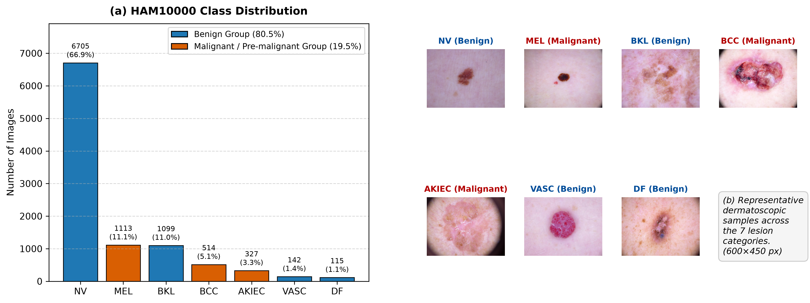
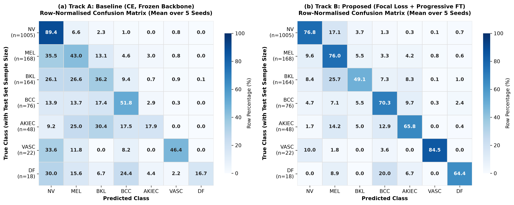

# Skin Lesion Classification on HAM10000

A seven-class skin lesion classifier built on ResNet50, where the real question was not "how high can accuracy go" but **"how do I stop the model from missing melanomas"**.

On this dataset a model can look fine with 73% accuracy and still miss more than half of the melanomas. I ran 5 configurations × 5 random seeds to find out which change actually moves that number.

## The problem

HAM10000 has 10,015 dermoscopy images in 7 classes, and the classes are very unbalanced: `nv` (benign mole) is about 67% of the data, while `mel` (melanoma), `bcc` and `akiec` are rare. A model trained with plain cross entropy learns "when in doubt, say nv" and gets a nice accuracy while being useless for the thing that matters.

So I treated **melanoma recall** and **malignant recall** (mel/bcc/akiec grouped) as the primary metrics, and accuracy as a secondary one.

## Results (mean ± std over 5 seeds, test set)

| Track | Loss | Backbone | Acc | Malignant recall | Melanoma recall | Macro F1 | Macro AUROC |
|---|---|---|---|---|---|---|---|
| A | CE | frozen | 72.7 ± 0.8 | 56.8 ± 6.5 | 43.0 ± 7.5 | 44.8 ± 3.7 | 90.1 ± 0.4 |
| B1 | CE | progressive FT | **80.2 ± 0.9** | 71.8 ± 2.4 | 56.2 ± 5.1 | 67.5 ± 1.9 | 95.3 ± 0.4 |
| B2 | Focal | frozen | 66.3 ± 4.5 | 74.0 ± 8.8 | 59.0 ± 13.8 | 46.5 ± 2.5 | 89.5 ± 0.3 |
| C | Weighted CE | progressive FT | 75.8 ± 2.6 | 80.9 ± 2.9 | 71.3 ± 5.3 | 65.1 ± 4.0 | 94.8 ± 0.5 |
| B | Focal | progressive FT | 73.0 ± 3.5 | **86.0 ± 1.3** | **76.0 ± 2.7** | 64.3 ± 4.4 | 94.2 ± 0.5 |

What the numbers say:

- **Freezing the backbone is the worst choice for recall.** Baseline A misses 57% of melanomas. That is the failure mode I wanted to fix.
- **Progressive fine-tuning is what buys accuracy.** B1 vs A: 72.7 → 80.2 accuracy, and melanoma recall 43.0 → 56.2.
- **The loss function is what buys recall.** B vs B1: same backbone schedule, only the loss changes (focal vs CE), melanoma recall 56.2 → 76.0, malignant recall 71.8 → 86.0. Accuracy drops 80.2 → 73.0, which is the trade I was willing to make.
- **Focal loss with a frozen backbone is unstable** — B2 has the widest spread (melanoma recall 59.0 ± 13.8) and the lowest accuracy. Focal loss needs the backbone to adapt with it.
- **C is the compromise.** 75.8 accuracy and 71.3 melanoma recall — if you will not accept a 7-point accuracy drop, weighted CE is the better lever.

## How the data was split

This part matters more than the model. HAM10000 has multiple images per lesion (`lesion_id`), so a plain random split leaks the same mole into train and test and the score becomes fake.

I used `StratifiedGroupKFold` grouped by `lesion_id` for a 70/15/15 split, and the script asserts that the train, val and test lesion sets do not overlap (it prints `Zero lesion_id overlap` when it passes). The manifest is `results/splits.csv` if you want to check.

## Setup

- Backbone: ResNet50 (ImageNet pretrained), new 7-way head, dropout 0.3
- Progressive unfreezing: head → layer4 → layer3, with different learning rates per stage
- Losses compared: plain CE, focal loss (γ=2), inverse-frequency weighted CE
- 5 seeds per track: 42, 100, 2026, 7, 99 — every number above is a mean over 5 full runs, not a lucky one
- Metrics computed per run and saved to `results/metrics/*.json`

## Repository layout

```
01_prepare_data.py            dataset download / cleanup, grouped split, leakage check
02_core_modules.py            Dataset, FocalLoss, class weights, ResNet50 wrapper, unit tests
03_run_experiments.py         5 tracks × 5 seeds, training, evaluation, per-run metrics
04_polish_plots_and_stats.py  plots and the cross-seed statistics
05_build_word_report.py       builds the Word report from the metrics
figures/                      EDA and confusion matrices
results/                      all_test_results.csv + 25 per-run metric files + splits.csv
```

`02_core_modules.py` has a `run_unit_tests()` that checks the dataset shapes and the loss values before any training starts — running that first saved me a few silent failures.

## Figures

**Class distribution and image samples (EDA)**



**Confusion matrices for the five tracks**



## Environment

```bash
pip install torch torchvision timm pandas numpy scikit-learn scipy matplotlib seaborn
```

The dataset is not in this repo (about 3GB). `01_prepare_data.py` can download it or point at a local folder, and it expects the standard `HAM10000_metadata.csv` + two image folders.

Model weights are not uploaded either (90MB per checkpoint, 25 of them). Run `03_run_experiments.py` to reproduce a track, or load the metrics in `results/` if you only want to see the numbers.
